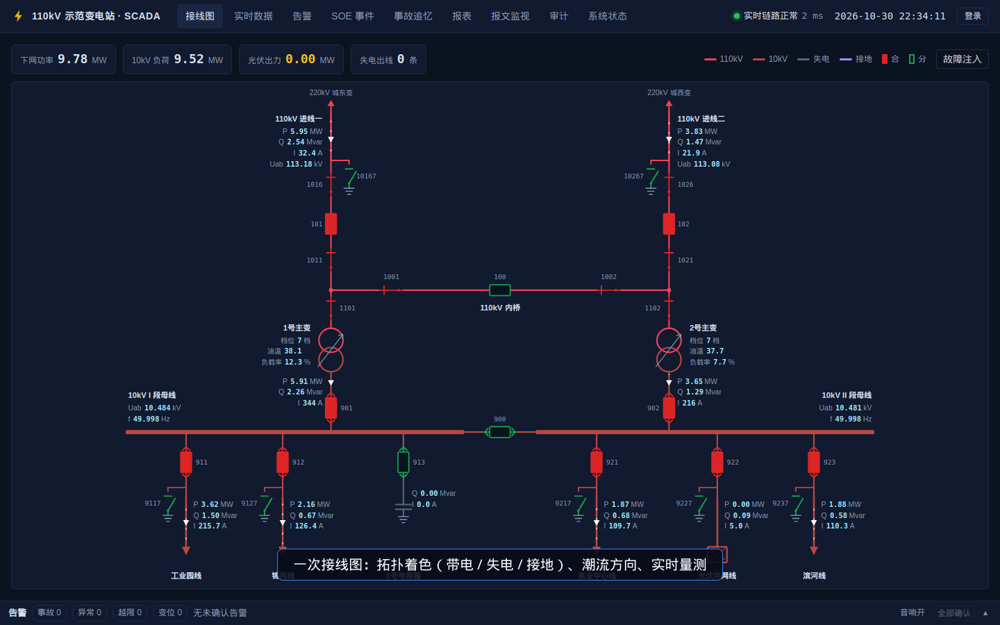
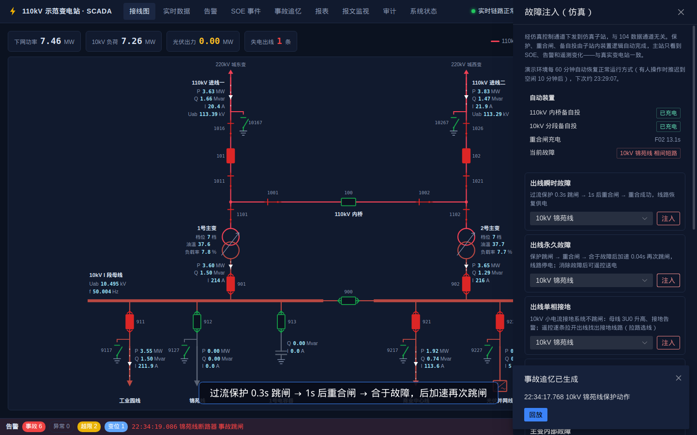
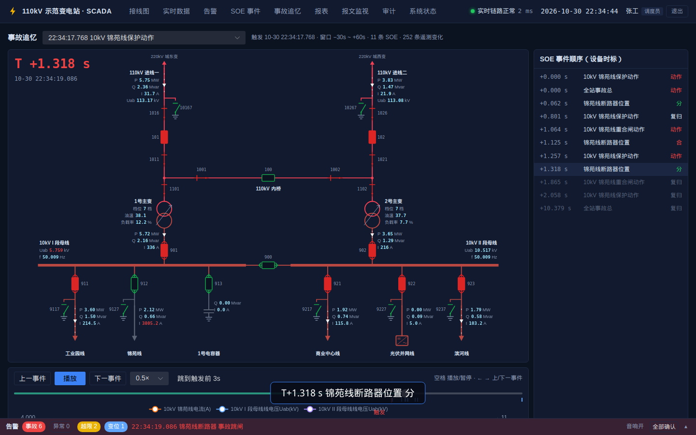
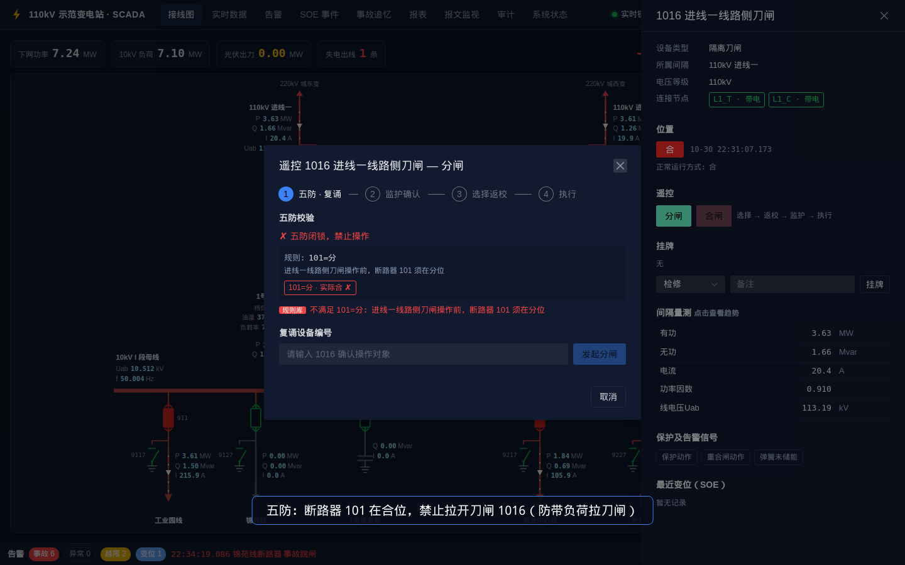
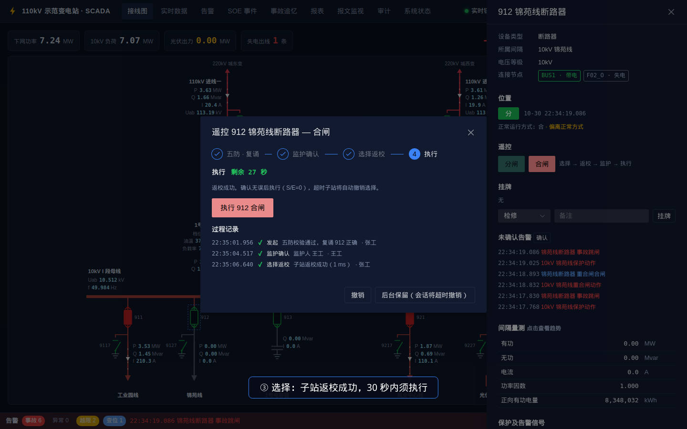
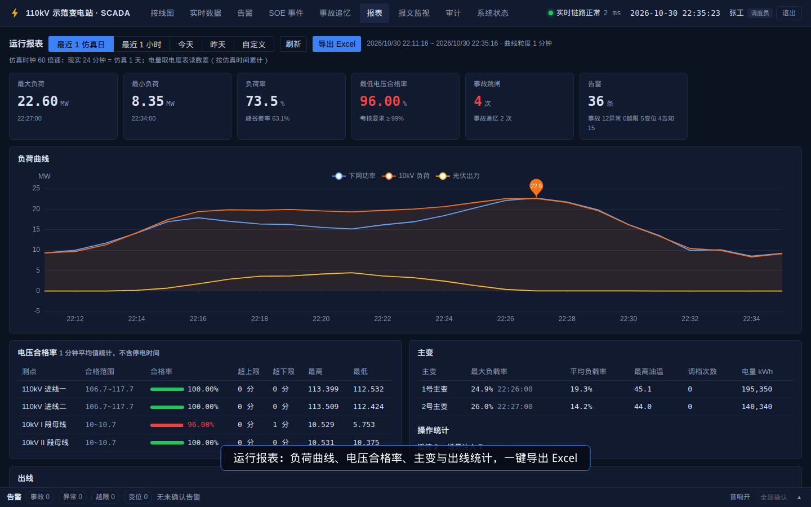
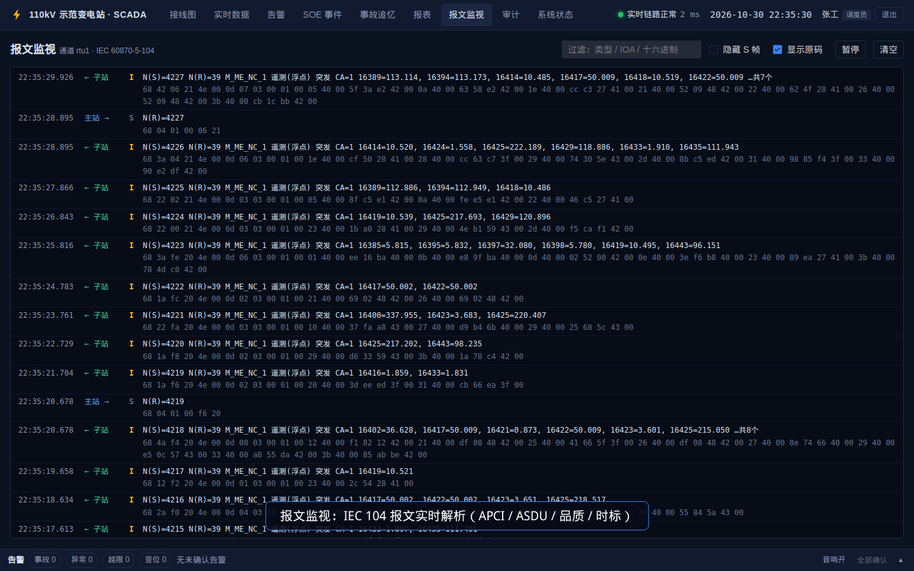

# PowerGrid SCADA Demo

电力系统 SCADA（数据采集与监视控制）演示系统。用潮流计算仿真一座 110kV 变电站，经 **IEC 60870-5-104** 规约接入主站，完整走通"厂站 → 通道 → 前置 → SCADA → 人机界面"的真实链路：采集、实时处理、告警与 SOE、遥控（五防 + 选择-返校-执行）、一次接线图拓扑着色、事故追忆、运行报表，以及数据校核、负荷预测、事故简报等智能分析。

- 在线演示：<http://141.164.45.82:8088>（演示账号见[演示](#演示)，每 60 分钟自动恢复正常运行方式）
- 设计方案：[docs/开发方案.md](docs/开发方案.md) · 点表：[docs/点表.csv](docs/点表.csv)（153 个点，由厂站模型生成）
- 进度：P0 骨架 ✅ · P1 数据链路 ✅ · P2 接线图 ✅ · P3 告警/遥控/五防 ✅ · P4 故障场景/事故追忆 ✅ · P5 报表/自动复位/演示 ✅ · P6 数据校核/负荷预测/事故简报 ✅



| 故障注入：永久故障后加速跳闸 | 事故追忆：按 SOE 时标逐事件回放 |
|---|---|
|  |  |
| **五防闭锁：防带负荷拉刀闸** | **遥控：选择返校 → 监护 → 执行** |
|  |  |
| **运行报表：负荷曲线、电压合格率** | **报文监视：IEC 104 实时解析** |
|  |  |

## 目录

- [项目功能](#项目功能)
- [演示](#演示)
- [系统架构](#系统架构)
- [电力 SCADA 业务知识](#电力-scada-业务知识)
  - [1. SCADA 是什么：四遥与分层结构](#1-scada-是什么四遥与分层结构)
  - [2. 变电站一次接线](#2-变电站一次接线)
  - [3. 倒闸操作与五防](#3-倒闸操作与五防)
  - [4. 遥控：选择-返校-执行](#4-遥控选择-返校-执行)
  - [5. IEC 60870-5-104 规约](#5-iec-60870-5-104-规约)
  - [6. 数据质量：死区、品质位、时标与 SOE](#6-数据质量死区品质位时标与-soe)
  - [7. 告警分级与越限](#7-告警分级与越限)
  - [8. 继电保护与站内自动装置](#8-继电保护与站内自动装置)
  - [9. 拓扑着色](#9-拓扑着色)
  - [10. 运行指标与智能分析](#10-运行指标与智能分析)
- [技术要点](#技术要点)
- [本地开发](#本地开发)
- [Docker 部署](#docker-部署)
- [接口](#接口)

---

## 项目功能

| 功能 | 说明 |
|---|---|
| **一次接线图** | SVG 自绘：110kV 内桥 + 10kV 单母分段；拓扑着色（带电/失电/接地）、潮流方向动画、实时量测、越限变色、品质灰显、变位闪烁；点击设备看台账、SOE、趋势 |
| **实时数据** | 全站遥测/遥信列表，按间隔筛选，品质位与时标；趋势曲线（原始值 / 1 分钟聚合自动切换） |
| **告警** | 事故 / 异常 / 越限 / 变位 / 告知五级；全局告警窗、音响、未确认闪烁、确认；检修挂牌自动抑制；光字牌 |
| **SOE** | 按设备毫秒时标排序的事件顺序记录 |
| **遥控 / 遥调** | 五防校验 + 复诵 → 监护人确认 → 选择返校 → 执行，任一步可撤销、超时自动撤销；主变升降档、光伏有功设定；挂牌（检修、禁止合闸、临时接地线） |
| **故障注入** | 出线瞬时/永久故障、单相接地、进线失电、主变内部故障、电压偏高、通道中断、量测故障（CT 极性接反/变送器卡死/量程错误） |
| **站内自动装置** | 过流保护、一次重合闸、后加速、主变差动/重瓦斯、两级备自投（时间级差配合） |
| **事故追忆（PDR）** | 事故自动生成追忆，从事故前 30 秒全站断面开始按 SOE 时标逐事件回放，接线图重现开关动作 |
| **事故简报** | 从追忆数据提取事实，按规则定性并给出处置建议；可选由大模型基于同一份事实撰写 |
| **运行报表** | 负荷曲线与负荷特性、电压合格率、主变与出线统计、告警与操作统计；导出 Excel |
| **负荷预测** | 相似日法预测未来 1 个仿真日的 10kV 负荷，上一日回测准确率 |
| **数据校核** | 节点功率平衡 + 间隔自洽，发现坏数据并定位到间隔 |
| **报文监视** | IEC 104 报文实时解析：APCI、ASDU、品质、时标 |
| **审计 / 权限** | 访客只读、调度员、监护员、管理员；登录、遥控每一步、挂牌、告警确认、场景注入全部留痕 |
| **系统状态** | 各服务、104 通道（收发帧数、总召、对时）、实时推送延迟 |
| **自动复位** | 公开演示站定时恢复正常运行方式（有人操作时推迟） |

## 演示

演示账号（`DEMO_MODE=true` 时登录框会列出），口令都是 `scada@2024`：

| 账号 | 姓名 | 角色 | 权限 |
|---|---|---|---|
| `zhang` / `li` | 张工 / 李工 | 调度员（operator） | 遥控遥调、挂牌、确认告警、故障注入 |
| `wang` | 王工 | 监护员（supervisor） | 遥控监护确认、审计查看，以及调度员权限 |
| `admin` | 系统管理员 | 管理员 | 审计查看、故障注入 |
| — | — | 访客（未登录） | 只读 |

5 分钟演示路线（与 `scripts/demo/record.mjs` 自动录制的视频一致）：

1. **接线图**：拓扑着色、潮流方向、实时量测
2. **登录 → 故障注入「出线永久故障」**：保护跳闸 → 重合 → 后加速再跳；告警窗事故音响，线路失电变灰
3. **点通知「回放」**：事故追忆按 SOE 毫秒时标单步重放；右上角「事故简报」查看自动生成的简报
4. **「消除故障」后遥控**：先试拉 1016 刀闸被五防闭锁，再对 912 合闸（复诵 → 监护 → 选择返校 → 执行）恢复送电
5. **确认告警**；报表页看负荷曲线、负荷预测，导出 Excel；报文监视看 104 报文解析
6. （可选）注入「CT 极性接反」，到系统状态页看数据校核定位到该间隔

录制演示视频与截图：

```bash
cd scripts/demo && npm i && npx playwright install chromium
node record.mjs http://127.0.0.1:18088   # 输出 out/demo.mp4 与 docs/images/*.png
```

## 系统架构

```
浏览器 ──HTTP(S)/WS──► gateway  Caddy：前端静态页面 + 反向代理（有域名时自动 HTTPS）
                          │ /api  /ws
                          ▼
                         api  FastAPI：REST、WebSocket 推送；后台运行告警引擎、
                          │   数据校核、遥控会话、历史库写入、事故追忆、自动复位
                ┌─────────┴──────────┐
                ▼                    ▼
              redis               db（TimescaleDB）
     实时库 + 消息总线          历史遥测（hypertable + 1 分钟聚合）、
   （实时值、变化流、SOE 流、    SOE、告警、审计、事故追忆、用户、点表
     遥控命令、仿真控制通道）
                ▲
                │
               fep  前置机：IEC 104 主站（建链、总召、对时、收数、下发遥控）
                ▲
                │ IEC 104（TCP 2404，仅容器内网）
                │
             rtu-sim  仿真子站：pandapower 潮流 + 保护/自动装置 + IEC 104 子站
```

对应真实调度自动化系统的 **厂站 RTU → 通道 → 前置 FEP → SCADA 服务器 → 人机界面** 结构。rtu-sim 和 fep 是两个独立进程，它们之间走真实的 TCP 104 报文："报文监视"看到的就是这条链路上的帧，"通道中断"场景也是真的断开连接。

| 容器 | 角色 | 说明 |
|---|---|---|
| `rtu-sim` | 子站（RTU/测控装置） | 潮流计算、负荷曲线、开关动作过程、保护与自动装置、间隔层联锁，IEC 104 从站 |
| `fep` | 前置机 | IEC 104 主站；品质处理、变化检测、SOE、报文记录，转发遥控命令 |
| `redis` | 实时库 / 消息总线 | 每个测点的最新值；Redis Streams 传变化数据、SOE、遥控命令、仿真控制 |
| `db` | 历史库 | TimescaleDB（PostgreSQL 16 + 时序扩展） |
| `api` | SCADA 应用服务 | 见上 |
| `gateway` | 网关 | 前端静态页面 + `/api`、`/ws` 反向代理 |

| 目录 | 说明 |
|---|---|
| `config/station.yaml` | 厂站模型（单一事实来源）：主接线、设备参数、负荷特性；点表由它按规则生成 |
| `config/interlock.yaml` | 五防规则库 |
| `packages/scadalib` | 共享库：**自研 IEC 104 规约栈**、厂站模型与点表生成、拓扑分析、仿真时钟 |
| `services/rtu-sim` | 仿真子站 |
| `services/fep` | 前置采集 |
| `services/api` | SCADA 服务（`alarm` 告警与数据校核、`control` 遥控与五防、`reports` 报表、`forecast` 负荷预测、`brief` 事故简报） |
| `web` | Vue 3 人机界面；`web/Dockerfile` 构建网关镜像 |
| `deploy` | Caddyfile、数据库初始化脚本 |
| `scripts/demo` | 演示视频与截图录制脚本 |

---

## 电力 SCADA 业务知识

本节整理项目涉及的电力 SCADA 基础知识，每条都对应系统里能看到、能操作的功能。

### 1. SCADA 是什么：四遥与分层结构

SCADA（Supervisory Control And Data Acquisition）是调度自动化系统的基础功能：把分散在各变电站的电气量采集到调度中心，供调度员监视，并下发控制命令。

**四遥**是 SCADA 最基本的数据分类：

| 类别 | 方向 | 含义 | 本项目示例 |
|---|---|---|---|
| 遥测（YC） | 厂站 → 主站 | 连续变化的模拟量 | 母线电压、线路 P/Q/I、功率因数、主变油温、频率 |
| 遥信（YX） | 厂站 → 主站 | 开关量状态 | 断路器/刀闸位置、保护动作、重合闸动作、事故总 |
| 遥控（YK） | 主站 → 厂站 | 分合命令 | 断路器分闸/合闸 |
| 遥调（YT） | 主站 → 厂站 | 调节命令 | 主变分接头升降档、光伏有功设定 |

另有**电度**（累计量，如正向有功电量）和 **SOE**（带毫秒时标的事件顺序记录）。

**分层结构**：厂站侧的 RTU 或测控装置采集数据 → 经通道（专线或调度数据网）用规约上送 → 主站**前置机**负责通信和规约解析 → **SCADA 服务器**做实时处理、告警、存储 → **人机界面**给调度员监视和操作。本项目的 6 个容器就是按这个结构拆分的。

**点表**是厂站和主站的约定：每个测点有唯一的信息体地址（IOA），双方据此对应数据。本项目按国内 104 实施细则常用的分段分配地址：遥信从 `0x0001`、遥测从 `0x4001`、遥控从 `0x6001`、遥调从 `0x6201`、电度从 `0x6401` 开始。点表由厂站模型自动生成（`make points`）。新间隔追加在末尾，已有地址不变。

### 2. 变电站一次接线

**一次设备**是直接承载电能的设备（断路器、刀闸、主变、母线、线路），**二次设备**是保护、测控、通信等。

| 设备 | 作用 | 能否切断负荷电流 |
|---|---|---|
| 断路器 | 正常分合负荷电流，故障时由保护跳闸切断短路电流 | 能，包括短路电流 |
| 隔离刀闸 | 形成明显可见的断开点，保证检修安全 | **不能**，只能在无电流时操作 |
| 接地刀闸 | 检修时把已停电的设备接地，防止突然来电伤人 | 只能在无电压时合上 |

**本站主接线**：

- **110kV 内桥接线**：两回进线（101、102）各带一台主变，两条进线之间用桥断路器 100 连接，100 正常**热备用**（断开，随时可合）。主变高压侧不设断路器，只有刀闸（1101、1102）。设备少、投资省，适合进线较长、主变不需要频繁投切的终端站。代价是：主变检修时，要断开对应进线和桥开关才能让主变停电。
- **10kV 单母线分段**：两段母线各由一台主变供电，分段断路器 900 正常热备用，两段**分列运行**。原因有三点：
  1. **限制短路电流**：两台主变低压侧并列时，短路电流约为单台的两倍，可能超过 10kV 开关的遮断能力。
  2. **缩小故障范围**：一段母线故障只影响本段负荷。
  3. **避免环流**：两台主变的阻抗、档位不完全一致，并列会产生环流。

  可靠性由 **10kV 分段备自投**保证：一台主变失电后，自动合上 900，由另一台主变带全部负荷。五防规则里也有"两台主变低压侧都运行时禁止合分段开关"。
- **设备编号**沿用调度命名习惯：断路器 101/102/100/901/902/900/9xx；母线侧刀闸 xxx1；线路（主变）侧刀闸 xxx6；线路接地刀 xxx67；10kV 出线为中置式开关柜（手车断路器），不设刀闸，只有出线接地刀 9xx7。

### 3. 倒闸操作与五防

**倒闸操作**是改变设备运行状态（运行 / 热备用 / 冷备用 / 检修）的操作。基本顺序：

- **停电**：先断开断路器 → 再拉开**线路侧**刀闸 → 最后拉开**母线侧**刀闸 → 验电 → 合接地刀（或挂接地线）
- **送电**：顺序相反，先拆除接地 → 合母线侧刀闸 → 合线路侧刀闸 → 最后合断路器

先拉线路侧刀闸的原因：如果断路器实际没有断开，拉刀闸时产生的电弧短路发生在线路侧，由本线路保护切除，只影响这一回线；如果先拉母线侧刀闸，故障就落在母线上，会造成整段母线停电。

**内桥接线示例**：

- **进线一检修，1 号主变不停电**：合桥开关 100 → 分 101 → 拉 1016 → 拉 1011 → 在线路侧验电 → 合 10167。两回进线来自不同电源，先合 100 再分 101 属于"合环"操作，需要调度确认两侧允许合环；不允许时先分 101 再合 100，1 号主变会短时停电。
- **1 号主变检修**：分 901（先断开低压侧负荷）→ 分 101 和 100（主变高压侧没有断路器，只能断开进线和桥开关使主变失电）→ 拉 1101。这就是五防规则 `1101: 901=分 & 101=分 & 100=分` 的由来。

**五防**是防止误操作的五项要求：

1. 防止误分、误合断路器
2. 防止带负荷拉、合隔离刀闸
3. 防止带电挂（合）接地线（接地刀闸）
4. 防止带接地线（接地刀闸）合断路器（隔离刀闸）
5. 防止误入带电间隔

本项目在主站和间隔层设了两道防线，互为备用：

- **主站规则库**（`config/interlock.yaml`）：表达式，例如 `1016: 101=分`，表示 1016 刀闸操作前断路器 101 须在分位，防止带负荷拉刀闸。
- **主站拓扑防误**：先模拟操作后的拓扑，若会出现"带电又接地"的节点（带地线合闸、带电合接地刀），或接地线挂在带电节点上，就闭锁。
- **挂牌闭锁**：检修牌禁止一切遥控，禁止合闸牌禁止合闸。
- **位置不确定闭锁**：设备在中间态、不定态或品质无效时禁止操作。
- **子站间隔层联锁**（rtu-sim）：断路器合位时，禁止操作同间隔的刀闸。

选择和执行前，主站各复核一次五防。

### 4. 遥控：选择-返校-执行

遥控直接改变电网状态，误动后果严重，所以采用 **SBO（Select Before Operate，选择-返校-执行）**，并配合人员上的双重确认。

**人员流程**：

1. **复诵**：操作人输入设备编号，确认操作对象。
2. **监护**：由另一名监护员用自己的账号口令确认，同一人不能既操作又监护。
3. **选择**：主站发送选择命令，子站检查对象和状态无误后**返校**（回复确认）。
4. **执行**：返校后 30 秒内必须执行，超时由子站自动撤销选择。

每一步都可以撤销，每一步都写入审计日志。

**规约层**（双点遥控 `C_DC_NA_1`）：

```
主站 → 子站  C_DC_NA_1  COT=6 激活      S/E=1（选择）  DCS=2（合）
子站 → 主站  C_DC_NA_1  COT=7 激活确认  S/E=1          ← 返校成功（P/N=1 为否定确认，选择失败）
主站 → 子站  C_DC_NA_1  COT=6 激活      S/E=0（执行）
子站 → 主站  C_DC_NA_1  COT=7 激活确认  S/E=0
子站 → 主站  M_DP_TB_1  COT=3 突发      断路器位置 = 合（带毫秒时标的 SOE）
子站 → 主站  C_DC_NA_1  COT=10 激活终止                ← 命令执行完毕
撤销：主站发 COT=8 停止激活 → 子站回 COT=9 停止激活确认
```

两步命令的意义：选择阶段子站确认对象正确、状态允许，执行阶段才真正出口。即使执行报文在传输中出错，没有经过选择的对象也不会动作。执行时命令值与选择时不一致，子站同样拒绝。

**遥调**：`C_RC_NA_1` 升降命令（主变调档，OLTC 每档约 5 秒）、`C_SE_NC_1` 浮点设点（光伏有功限值），同样有激活 → 激活确认 → 激活终止的过程。

### 5. IEC 60870-5-104 规约

IEC 104 是国内调度自动化最常用的厂站通信规约，在 TCP/IP 上传输（端口 2404）。"**自研规约栈**"指本项目自己实现了这个**国际标准规约**的编解码和链路状态机（`packages/scadalib/scadalib/iec104`，纯 asyncio，无第三方依赖），不是自定义接口。它能和其他厂家的 104 实现互通，测试里与 lib60870-C（c104）做了双向互操作验证。

**帧结构**

```
APCI（应用规约控制信息，6 字节）           ASDU（应用服务数据单元）
┌────┬─────┬────────────────────┐  ┌────────┬─────┬───────┬──────┬───────────┬──────────┐
│ 68 │ 长度 │ 控制域 4 字节       │  │类型标识 │ VSQ │ 传送原因 │公共地址│信息体地址  │ 信息元素  │
│起始│ 1B  │ 决定 I / S / U 帧   │  │ 1B     │ 1B  │ 2B     │ 2B   │ 3B        │ 值+品质+时标│
└────┴─────┴────────────────────┘  └────────┴─────┴───────┴──────┴───────────┴──────────┘
```

| 帧类型 | 用途 | 控制域 |
|---|---|---|
| **I 帧**（信息帧） | 携带 ASDU，传数据和命令 | 含发送序号 N(S) 和接收序号 N(R)，各 15 位，循环使用 |
| **S 帧**（监视帧） | 只确认收到的 I 帧，不带数据 | 只含 N(R) |
| **U 帧**（控制帧） | 链路控制 | STARTDT 启动数据传输、STOPDT 停止、TESTFR 链路测试 |

ASDU 字段：

- **类型标识**：数据类型，见下表。
- **VSQ**：信息体个数；SQ=1 表示地址连续，只写首地址。
- **传送原因（COT）**：1 周期、3 突发、5 请求、6 激活、7 激活确认、8 停止激活、10 激活终止、20 响应总召、37 响应电度召唤、44~47 未知类型/原因/公共地址/信息体地址。
- **公共地址**：厂站地址。
- **信息体地址（IOA）**：测点地址。

| 类型标识 | 名称 | 本项目用途 |
|---|---|---|
| 1 / 30 | `M_SP_NA_1` / `M_SP_TB_1` 单点遥信（30 带时标） | 保护动作、告警信号 |
| 3 / 31 | `M_DP_NA_1` / `M_DP_TB_1` 双点遥信（31 带时标） | 断路器、刀闸位置（01 分、10 合、00 中间态、11 不定态） |
| 13 | `M_ME_NC_1` 短浮点遥测 | 电压、电流、功率等 |
| 15 | `M_IT_NA_1` 累计量 | 电度 |
| 45 / 46 | `C_SC_NA_1` / `C_DC_NA_1` 单点 / 双点遥控 | 断路器分合 |
| 47 | `C_RC_NA_1` 升降命令 | 主变调档 |
| 50 | `C_SE_NC_1` 浮点设点 | 光伏有功设定 |
| 100 | `C_IC_NA_1` 总召唤 | 读取全部遥测遥信 |
| 101 | `C_CI_NA_1` 电度召唤 | 读取电度 |
| 103 | `C_CS_NA_1` 时钟同步 | 对时 |

**流量控制 k / w**：

- **k = 12**：发送方最多连续发送 12 个未被确认的 I 帧，达到后停止发送，等待对方确认。
- **w = 8**：接收方最迟收到 8 个 I 帧后必须回一次确认（S 帧，或在自己的 I 帧里捎带 N(R)）。

规约要求 w ≤ 2/3·k，保证发送方在被窗口卡住之前就能收到确认。

**定时器**（主站、子站两侧各自维护）：

| 定时器 | 默认 | 含义 |
|---|---|---|
| t0 | 30 s | 建立 TCP 连接超时（主站发起连接时使用） |
| t1 | 15 s | 发出 I 帧或 TESTFR 后等待对方确认的超时 |
| t2 | 10 s | 收到 I 帧后最迟多久发确认（无数据可捎带时发 S 帧），须 t2 < t1 |
| t3 | 20 s | 链路空闲多久发 TESTFR 测试帧 |

**t1 超时之后发生什么**：发送方认为链路故障，主动关闭 TCP 连接，未确认的 I 帧作废。主站侧把该通道所有数据的品质置为 NT（非当前值），画面灰显，产生"通道中断"告警。随后主站按 t0 周期重连，连接成功后依次执行 STARTDT → 对时 → 总召 → 电度召唤，用全站最新数据覆盖中断期间的旧值。故障注入里的"通道中断"演示的就是这个过程。

**数据怎么上送**：

- **突发上送（COT=3）**：遥信变位立即上送，带毫秒时标；遥测变化超过死区才上送。
- **总召唤（COT=20）**：主站发 `C_IC_NA_1`，限定词 QOI=20 表示"站总召唤"。子站回激活确认 → 上送全部遥信遥测 → 激活终止。用于建链后初始化，以及周期性校核（防止漏掉突发数据）。
- **电度召唤（COT=37）**：`C_CI_NA_1`，限定词 QCC=5 表示"总请求、只读不冻结"。报文监视里显示为"QCC=5 总请求"。
- **对时**：主站下发 `C_CS_NA_1`（CP56Time2a 7 字节时标：毫秒、分、时、日/星期、月、年），子站据此校正时钟。RTU 时钟不准时，SOE 时标也不准，所以建链后先对时。本项目的仿真 RTU 启动时故意带 1~2.5 秒偏差，对时后校正。

**报文示例**：

```
68 04 07 00 00 00              U 帧 STARTDT 激活（确认为 0B，TESTFR 激活 43 / 确认 83）
68 04 01 00 0A 00              S 帧，确认已收到序号 0~4 的 I 帧（N(R)=5，字节为 5 左移 1 位）
68 0E 00 00 00 00 64 01 06 00 01 00 00 00 00 14
   └ I 帧 N(S)=0 N(R)=0 │ 类型 100 总召 │ VSQ=1 │ COT=6 激活 │ 公共地址 1 │ IOA=0 │ QOI=20
68 12 04 00 0A 00 32 01 06 00 01 00 01 62 00 00 00 40 40 00
   └ I 帧 N(S)=2 N(R)=5 │ 类型 50 浮点设点（遥调）│ COT=6 激活 │ IOA=0x6201 │ 值 3.0（IEEE754 小端）│ QOS=0
```

### 6. 数据质量：死区、品质位、时标与 SOE

- **死区**：遥测变化超过死区才上送，避免噪声占满通道。例如 10kV 出线有功死区 0.05 MW、110kV 进线电流 2 A、10kV 母线电压 0.02 kV。代价是主站看到的值与真实值最多相差一个死区。数据校核的容差就是按死区计算的。
- **品质位**：每个值都带品质描述。IV 无效、NT 非当前值（通道中断后旧值）、SB 被取代（人工置数）、BL 被闭锁、OV 溢出。品质异常的量测在画面上灰显，不参与告警和计算。
- **时标**：遥信变位带 **设备时标**（RTU 在事件发生时记录，毫秒级）；短浮点遥测 `M_ME_NC_1` 不带时标，主站按收到的时间记录。所以事故回放时，电流、电压的变化会比 SOE 滞后几百毫秒。
- **SOE（事件顺序记录）**：按设备时标排序的遥信变位序列，用来分析"保护先动作、断路器 61 毫秒后跳开、1 秒后重合"这样的先后关系。
- **事故总 / 预告总**：全站事故信号的"或"，任一保护动作即触发事故总，用来触发事故追忆和音响。

### 7. 告警分级与越限

| 级别 | 含义 | 示例 | 处理 |
|---|---|---|---|
| 事故 | 保护动作、开关事故跳闸 | 锦苑线保护动作、912 事故跳闸 | 音响 + 闪烁，必须人工确认 |
| 异常 | 设备或系统异常 | 通道中断、重瓦斯、接地告警、数据校核异常 | 音响 + 闪烁，必须人工确认 |
| 越限 | 遥测超出限值 | 母线电压越上限、线路电流越限 | 需确认 |
| 变位 | 开关正常变位 | 遥控合闸成功 | 需确认 |
| 告知 | 恢复、提示类信息 | 越限恢复、通道恢复 | 自动确认 |

开关分闸按原因分类：

- **遥控变位**：主站有对应的遥控命令，记录操作人和监护人。
- **事故跳闸**：保护动作前后 5 秒内的分闸。
- **重合闸合闸**、**备自投分合闸**。
- 其余为**非遥控变位**（可能是现场就地操作）。

**越限**有四级限值：上上限、上限、下限、下下限。为避免负荷在限值附近来回波动造成反复告警，做了两项处理：

- **回差**：恢复时须回到限值以内 max(死区, 1% 限值)。
- **延时**：越限和恢复都要持续 10 秒才确认，越上上限立即告警。

本站电压限值：110kV 106.7~117.7 kV，10kV 10.0~10.7 kV，频率 49.8~50.2 Hz。母线失压时闭锁该母线的频率、零序告警，避免停电时满屏告警。挂了检修牌的间隔，告警自动抑制。

### 8. 继电保护与站内自动装置

| 装置 | 本站整定 | 动作逻辑 |
|---|---|---|
| **出线过流保护** | 0.3 s | 电流超过整定值并持续 0.3 秒，跳开本线路断路器 |
| **重合闸** | 1 s，动作后 15 s 充电 | 架空线路多数故障是瞬时性的（雷击、树枝碰线），跳闸后自动重合一次，成功即恢复供电 |
| **后加速** | 0.04 s | 重合或手动合闸于故障时，不再等 0.3 秒，加速跳闸，减少对设备的冲击 |
| **主变差动** | 速动 | 比较主变各侧电流，内部故障时差流很大，跳主变各侧断路器 |
| **重瓦斯 / 轻瓦斯** | — | 主变内部故障使油分解产生气体；轻瓦斯发告警，重瓦斯跳闸 |
| **110kV 桥备自投** | 1.5 s | 一回进线失电时，跳开该进线断路器，合上桥开关 100 |
| **10kV 分段备自投** | 3 s | 一段母线失电时，跳开该段主变低压侧断路器，合上分段 900 |

- **瞬时性与永久性故障**：重合成功说明是瞬时性故障；重合于故障被后加速再次跳开，说明是永久性故障，要巡线找到故障点、隔离后才能试送。
- **备自投的充电与放电**：备自投在正常运行方式下持续 10 秒才"充电"（具备动作条件）。手动分合相关开关会使它立即"放电"，防止调度员主动停电时备自投误合。主变差动、重瓦斯动作时闭锁桥备自投，避免把故障主变再投到另一条进线上。
- **时间级差配合**：进线失电时，两级备自投都会检测到失压。桥备自投 1.5 秒先动作，恢复了 10kV 电压；分段备自投（3 秒）随即检测到电压恢复，不再动作。上级先动、下级后动，避免两级同时动作造成多余的开关操作。故障注入「110kV 进线失电」演示的就是这个过程。
- **小电流接地系统**：10kV 系统中性点不接地或经消弧线圈接地。单相接地时故障电流很小，线电压仍然对称，可以继续运行（一般不超过 2 小时），所以保护不跳闸，只发接地告警。判断依据是母线零序电压 3U0 升高（本站约 92 V）。找出是哪条线路接地，传统方法是**拉路选线**：逐条短时拉开出线，3U0 消失的那条就是接地线路。

### 9. 拓扑着色

接线图的颜色不是写死的，而是由开关的实时状态计算出来的：

- 模型按 IEC 61970 CIM 的**连接节点**（ConnectivityNode）组织：每台设备连接 1~2 个节点，合位开关、线路、主变把节点连通。
- **带电**：从电源点出发，经合位开关、线路、主变做广度优先搜索，能到达的节点带电，按电压等级着色；到达不了的为失电（灰色）。
- **接地**：从合位接地刀或临时接地线出发，经合位开关和线路传递，但**不穿过主变**。主变两侧绕组之间只有磁耦合，没有电气连接，一侧接地不会使另一侧成为接地状态（所以主变检修要在两侧分别隔离、分别接地）。
- **带电又接地**：带电合接地刀属于恶性误操作，单独标红闪烁；五防的拓扑防误就是在操作前做这个计算。
- 开关在中间态、不定态或品质无效时按"不导通"处理，宁可少着色也不误着色。

### 10. 运行指标与智能分析

- **电压合格率** = (考核时间 − 越限时间) / 考核时间。用 1 分钟平均电压判断是否越限，停电时间不计入考核。
- **负荷率** = 平均负荷 / 最大负荷，越接近 1 说明用电越平稳。**峰谷差率** = (最大负荷 − 最小负荷) / 最大负荷。
- **主变负载率** = 视在功率 / 额定容量；调档次数反映电压调节的频繁程度。
- **数据校核（坏数据辨识）**：一个节点的功率流入应等于流出（基尔霍夫定律），一个间隔的 √(P²+Q²) 应约等于 √3·U·I。利用这些冗余关系，可以在一次设备完全正常时发现**测量回路**的问题，例如 CT 极性接反（有功变负、母线功率不平衡）、变送器卡死（数值不刷新）、量程设置错误（只有间隔自洽能发现）。
- **短期负荷预测（相似日法）**：同一时刻的负荷在相邻日之间高度相关。取前几日同一时刻加权平均，剔除事故停电等异常日，再用最近的实测值滚动修正。准确率按调度考核口径计算：1 − √(mean(((实际 − 预测) / 实际)²))。
- **事故简报**：值班员事故后要向调度汇报"什么时间、什么保护动作、跳了哪些开关、损失多少负荷、初步判断、下一步怎么处理"。系统从追忆数据中自动整理这些事实。

---

## 技术要点

**IEC 104 规约栈（`packages/scadalib/scadalib/iec104`）**
- APCI I/S/U 帧、15 位序号回绕；k/w 流量控制；t0~t3 定时器
- ASDU：单/双点遥信（含 CP56Time2a SOE）、短浮点遥测、电度、双点遥控、升降、设点、总召、电度召唤、对时；SQ=1 解码
- 子站：SBO 及超时/撤销、值不一致拒绝、否定确认（COT 44~47）
- 主站：断线重连、STARTDT → 对时 → 总召 → 电度召唤，周期召唤，命令等待激活确认/激活终止
- 与 lib60870-C（c104）双向互操作测试

**仿真子站**
- pandapower 交流潮流，开关分合真实改变拓扑
- 工业/居民/商业典型日负荷曲线 + OU 随机过程；光伏晴空曲线 × 云量
- 60 倍速仿真时钟，对齐本地时间：每个整点、24 分、48 分为仿真零点（`scadalib/simclock.py`），子站重启后历史数据的仿真钟点不变
- 刀闸 3 秒行程（双点"中间态"）、OLTC 5 秒/档、IEC 60076-7 顶层油温模型、电度积分
- 量测故障注入（CT 极性、变送器卡死、量程错误）只影响上送值，不影响潮流

**一次接线图（`web/src/diagram`、`web/src/lib/topology.ts`）**
- 图模分离：布局文件只存坐标和模型引用，`layout.test.ts` 对照模型与点表做图模一致性校验
- 配色：110kV 朱红、10kV 绛红（Q/GDW 624），失电灰；开关红合绿分

**告警与数据校核（`services/api/app/alarm`）**
- 规则引擎消费 Redis 变化流与 SOE 流；越限回差与延时；检修抑制
- 数据校核每 2 秒对实时断面计算一次；异常持续 15 秒告警，消失 15 秒恢复（避开短路暂态）；功率不平衡结合间隔自洽定位可疑间隔

**遥控（`services/api/app/control`）**
- 会话状态机：pending → authorized → selected → done，任一步可撤销，选择后 30 秒超时自动撤销
- 认证：PBKDF2 口令 + JWT；登录限流；全部操作写审计日志

**事故追忆与简报**
- 事故总 / 保护 / 自动装置动作自动生成追忆；同一事故 20 秒内的后续动作合并
- 回放数据 = 触发前 30 秒全站断面 + 窗口内全部遥测变化与 SOE，前端从断面出发逐条应用
- 简报以最后一个保护或自动装置信号后 2 秒作为事故过程的结束，之后的操作单列；配置 `ANTHROPIC_API_KEY` 后可由大模型（默认 `claude-opus-5-5`）基于同一份事实撰写，开启了服务端 `fallbacks: "default"`（模型拒答时由服务端换模型重试）

**报表与负荷预测**
- 历史库只存变化：统计前按"前值保持"补齐没有变化记录的分钟
- 负荷预测：前 7 个仿真日同一时刻加权平均，剔除偏离中位数 25% 以上的值，最近 1 小时实测滚动修正（限幅 ±15%）；离线回测约 99%
- 仿真负荷没有气象、节假日等特征，LightGBM 等模型只能学到同一时刻的历史值，所以选了可解释的相似日法；接口按"历史序列 → 预测序列"设计，可替换

**实时与历史**
- 历史写入：Redis Stream 消费组 + 批量 COPY，写库成功才 ACK（至少一次）
- TimescaleDB hypertable、1 分钟连续聚合、3 天后压缩、30 天保留
- 推送：按画面订阅、200 ms 合帧、只推增量

---

## 本地开发

环境：Linux / WSL2、Docker（含 compose 插件）、Python 3.12、Node.js 20+、make、tmux。

本机有两种运行方式。日常开发用**本机开发模式**；**Docker 开发模式**用于部署前验证镜像，Docker 生产部署只在服务器上使用（见 [Docker 部署](#docker-部署)）。

| | 本机开发模式 `make local` | Docker 开发模式 `make up-full` |
|---|---|---|
| db、redis | Docker 容器 | Docker 容器 |
| rtu-sim、fep、api | 本机进程（tmux），改代码即时生效，可打断点 | 容器；只有 api 热重载，fep/rtu-sim 改动需重新构建镜像 |
| 前端 | Vite http://localhost:5173 | 网关镜像 http://localhost:18088 |
| 用途 | 日常开发调试 | 提交/部署前验证镜像和容器间连通 |

两种方式共用同一个 Redis，不能同时运行：`make local` 启动时会自动停掉 Docker 里的 api/fep/rtu-sim/gateway；切回 Docker 时先执行 `make local-stop` 再执行 `make up-full`。

### 首次准备

```bash
git clone https://github.com/rfs151/ai-scada.git && cd ai-scada
make env        # 生成本地 .env（开发口令、镜像标签 dev）
make venv       # 创建 .venv（全部 Python 服务 + 测试工具）
```

### 本机开发模式（推荐）

```bash
make local                  # 一键启动并自检；已在运行时只做自检 → http://localhost:5173
make local-check            # 只做自检
make local-attach           # 进入 tmux 看实时日志（Ctrl-b n 切换窗口，Ctrl-b d 退出）
make local-restart S=fep    # 重启单个进程：rtu-sim / fep / api / web
make local-stop             # 停止本机进程（db/redis 容器保留）
```

`make local`（脚本 `scripts/local.sh`）依次完成：

1. 停掉 Docker 里的业务容器，避免两套仿真/前置同时写 Redis；
2. 启动 db、redis 容器并等待健康；
3. 在 tmux 会话 `ai-scada-local` 中启动 4 个进程：rtu-sim（104 子站 2404）、fep、api（18000，`--reload` 热重载）、web（Vite 5173）；
4. 自检，任一项失败即报错退出：

| 检查项 | 判断方法 |
|---|---|
| 进程存活 | 4 个 tmux 窗口都在且进程未退出（进程退出后窗口保留，方便看报错） |
| API 就绪 | `GET /api/health` 返回 ok（数据库、实时库均正常） |
| 104 通道 | Redis `ch:rtu1` 状态为 `up` |
| 数据在刷新 | Redis 流 `rt:chg` 3 秒内有新数据 |
| 前端 | Vite 页面可访问，且 `/api` 代理到 api 正常 |

各进程日志同时写入 `.run/<服务名>.log`（已在 `.gitignore` 中）。配置文件无需额外设置：scadalib 以可编辑方式安装，会自动找到仓库里的 `config/station.yaml`（也可用环境变量 `STATION_CONFIG` 指定）。

### Docker 开发模式

```bash
make dev        # 后端全链路 db/redis/rtu-sim/fep/api（api 热重载）→ http://localhost:18000/docs
make web-dev    # 配合 make dev：本机起前端 → http://localhost:5173
make up-full    # 生产形态（含网关）→ http://localhost:18088
make ps         # 容器状态
make logs       # 跟踪日志
make down       # 停止（保留数据卷）
make clean      # 停止并删除数据卷（清空数据库）
```

开发编排叠加了 `docker-compose.dev.yml`，网关属于 `full` profile。直接用 `docker compose` 命令时，必须同时带上两个 `-f` 和 `--profile full`，否则会按生产配置重建容器，端口映射和热重载都会变化：

```bash
alias dc='docker compose -f docker-compose.yml -f docker-compose.dev.yml --profile full'

dc ps                                  # 状态与健康检查
dc logs -f --tail=200 api              # 单个服务日志：api / fep / rtu-sim / gateway / db / redis
dc restart fep rtu-sim                 # 重启采集链路
dc up -d --build api                   # 改代码后重建单个服务
dc exec db psql -U scada -d scada      # 连接数据库
dc exec redis redis-cli                # 连接实时库
docker stats --no-stream               # 资源占用
docker image prune -f && docker builder prune -f   # 清理旧镜像和构建缓存
```

数据库备份与恢复命令与生产相同，见 [日常运维](#8-日常运维)（命令前缀换成 `dc`）。

### 测试与工具

```bash
make test       # 规约栈/仿真/前置/api 的 pytest + 前端 vitest
make lint       # ruff + vue-tsc
make points     # 导出点表 docs/点表.csv
make help       # 列出全部命令
```

### 开发端口

只绑定 127.0.0.1，可在 `.env` 修改。

| 端口 | 服务 | 说明 |
|---|---|---|
| 5173 | 前端 Vite | 本机开发模式 / `make web-dev` |
| 18088 | 网关 | Docker 开发模式的完整页面 |
| 18000 | api | `/docs` 为 OpenAPI 文档；两种模式相同 |
| 2404 | 仿真子站 104 | 本机开发模式，监听 0.0.0.0，Windows 上的 104 调试工具可直接连接 |
| 12404 | 仿真子站 104 | Docker 开发模式，映射容器内 2404 |
| 5432 / 6379 | 数据库 / Redis | 本机调试 |

WSL mirrored 网络模式下，Windows 占用了 8000/8080/18080，所以开发端口避开了这几个。国内构建镜像时，可在 `.env` 设 `PIP_INDEX_URL`、`NPM_REGISTRY` 使用国内镜像源。

---

## Docker 部署

生产部署只需要一台装了 Docker 的 Linux 服务器。镜像在服务器上从源码构建，不依赖镜像仓库。以下以 Ubuntu 24.04 为例。

### 1. 服务器要求

- 2 核 2 GB 内存以上（全部容器常驻约 300 MB，compose 里各容器内存上限合计约 2.5 GB），磁盘 10 GB 以上
- 开放一个对外端口：默认 80/443；被占用时可改用其他端口，例如 8088
- 有域名时可自动申请 HTTPS 证书；没有域名时只提供 HTTP

### 2. 安装 Docker

```bash
# Ubuntu 24.04 官方源自带 docker.io 和 compose 插件
apt-get update
apt-get install -y docker.io docker-compose-v2
systemctl enable --now docker
docker --version && docker compose version
```

也可以按 Docker 官方文档安装 Docker CE。

### 3. 获取源码

```bash
mkdir -p /opt/ai-scada && cd /opt/ai-scada

# 方式一：仓库可访问时直接克隆
git clone https://github.com/rfs151/ai-scada.git .

# 方式二：私有仓库或服务器无法访问 GitHub 时，在本机打包上传
#   本机：git ls-files -z | tar --null -czf ai-scada.tgz -T -
#         scp ai-scada.tgz root@<服务器IP>:/tmp/
#   服务器：tar -xzf /tmp/ai-scada.tgz -C /opt/ai-scada
```

### 4. 配置 `.env`

在 `/opt/ai-scada/.env` 写入以下配置（参考 `.env.example`）。数据库口令和 JWT 密钥建议在服务器上随机生成：

```bash
cd /opt/ai-scada
cat > .env <<EOF
# 站点地址：:80 只走 HTTP；填域名（如 scada.example.com）则由 Caddy 自动申请 HTTPS 证书
SITE_ADDRESS=:80
# 宿主机端口：80/443 被其他服务占用时改成其他端口
HTTP_PORT=80
HTTPS_PORT=443

# 镜像名前缀与标签（在服务器上构建时随意命名即可）
IMAGE_PREFIX=ai-scada
IMAGE_TAG=prod

POSTGRES_USER=scada
POSTGRES_PASSWORD=$(openssl rand -hex 16)
POSTGRES_DB=scada
JWT_SECRET=$(openssl rand -hex 32)

# 公开演示：登录框列出演示账号；正式使用设为 false 并修改口令
DEMO_MODE=true
DEMO_PASSWORD=scada@2024
# 自动恢复正常运行方式的间隔（分钟），0 关闭
AUTO_RESET_MIN=60
# 仿真倍速：60 表示 24 分钟 = 1 个仿真日
SIM_SPEED=60

# 构建镜像用的国内镜像源（海外服务器留空）
PIP_INDEX_URL=
NPM_REGISTRY=

# 可选：事故简报由大模型撰写
ANTHROPIC_API_KEY=
BRIEF_MODEL=claude-opus-5-5
EOF
chmod 600 .env
```

| 变量 | 说明 |
|---|---|
| `SITE_ADDRESS` | `:80` 只提供 HTTP；填域名时，域名要先解析到服务器，且 80/443 能从公网访问（证书签发要通过 80 端口验证） |
| `HTTP_PORT` / `HTTPS_PORT` | 网关映射到宿主机的端口 |
| `POSTGRES_PASSWORD` / `JWT_SECRET` | 必须修改；JWT 密钥变更后已登录用户需重新登录 |
| `DEMO_MODE` / `DEMO_PASSWORD` | 演示账号开关与口令 |
| `AUTO_RESET_MIN` | 公开演示站自动复位间隔；有人操作时推迟到空闲 10 分钟后 |
| `SIM_SPEED` | 子站和 api 共用，报表与负荷预测据此换算仿真钟点 |
| `PIP_INDEX_URL` / `NPM_REGISTRY` | 国内服务器构建时使用，例如 `https://pypi.tuna.tsinghua.edu.cn/simple`、`https://registry.npmmirror.com` |
| `ANTHROPIC_API_KEY` / `BRIEF_MODEL` | 留空则事故简报只用规则模板 |

### 5. 构建并启动

```bash
cd /opt/ai-scada
docker compose build            # 构建 rtu-sim / fep / api / gateway 四个镜像，首次约 5~10 分钟
docker compose up -d            # 启动全部 6 个容器
docker compose ps               # db、redis、api、rtu-sim 应显示 healthy
```

服务器在国内、构建时下载依赖超时，可以在 `.env` 配置镜像源，或者让构建走代理：

```bash
docker build --network host \
  --build-arg HTTPS_PROXY=http://127.0.0.1:<代理端口> --build-arg HTTP_PROXY=http://127.0.0.1:<代理端口> \
  -f services/api/Dockerfile -t ai-scada-api:prod .
```

### 6. 验证

```bash
curl -s http://127.0.0.1:${HTTP_PORT:-80}/api/health | head -c 300   # status 应为 ok
docker compose logs --tail=50 fep                                      # 应看到 104 建链、对时、总召
```

浏览器打开 `http://<服务器IP>:<HTTP_PORT>`：

- 右上角显示"实时链路正常"
- 接线图数值每秒刷新
- 系统状态页 5 个组件均为"运行"

数据库首次启动时自动执行迁移、同步点表、创建演示账号。

### 7. 防火墙

- 只需要对外开放网关端口。数据库、Redis、104 端口都只在 compose 内网，生产 compose 不映射到宿主机。
- 注意：Docker 发布的端口会绕过 ufw 规则。只要映射了宿主机端口，就对公网开放，不需要另加 ufw 规则。不想对外开放时，在 compose 里改成 `127.0.0.1:端口:80` 的形式。
- 云服务器还要检查云厂商的安全组。

### 8. 日常运维

```bash
cd /opt/ai-scada
docker compose ps                         # 状态
docker compose logs -f --tail=100 api     # 日志（各容器日志已限制大小并轮转）
docker compose restart api                # 重启单个服务

# 更新：上传或拉取新代码后重新构建（.env 和数据卷不受影响）
git pull                                  # 或重新上传源码包解压覆盖
docker compose build && docker compose up -d

# 备份数据库
docker compose exec -T db pg_dump -U scada -Fc scada > scada-$(date +%F).dump
# 恢复（TimescaleDB 恢复前后需调用 pre/post_restore；先停写库的 api）
docker compose stop api
docker compose exec -T db psql -U scada -d scada -c "SELECT timescaledb_pre_restore();"
docker compose exec -T db pg_restore -U scada -d scada --clean --if-exists < scada-2026-10-31.dump
docker compose exec -T db psql -U scada -d scada -c "SELECT timescaledb_post_restore();"
docker compose start api

# 停止（保留数据）/ 彻底删除（含数据卷，不可恢复）
docker compose down
docker compose down -v
```

数据保存在 `db-data`（数据库）和 `caddy-data`（证书）两个卷中。历史遥测 30 天后自动删除，3 天后自动压缩，磁盘占用基本稳定。

### 9. 与其他服务共用服务器

- **80 端口被占用**：设置 `HTTP_PORT=8088`、`HTTPS_PORT=8443`，用 `http://<IP>:8088` 访问。在线演示站就是这样部署的。
- **需要 HTTPS 但 80 被占用**：Caddy 证书签发要通过 80 端口验证。可以让占用 80 端口的反向代理把本站域名转发到 8088，或者改用 DNS 验证方式签发证书。

### 10. CI 自动部署（可选）

`.github/workflows/ci.yml` 已包含"测试 → 构建镜像推送到 GHCR → SSH 到服务器拉取并重启"的流程，按需启用：

1. 服务器 `.env` 中设 `IMAGE_PREFIX=ghcr.io/<github用户名小写>/<仓库名小写>`、`IMAGE_TAG=latest`。
2. GitHub 仓库设置：
   - Variables：`DEPLOY_ENABLED=true`
   - Secrets：`VPS_HOST`、`VPS_USER`、`VPS_SSH_KEY`（建议使用专用部署密钥）
   - GHCR 包设为 public，或在服务器上执行 `docker login ghcr.io`
3. 推送到 `main` 后，CI 测试通过即自动构建并部署。

---

## 接口

完整接口文档见 `http://<地址>/docs`（OpenAPI）。

- `GET /api/health` 就绪探针（数据库、Redis、后台任务状态）· `GET /api/health/live` 存活探针
- `GET /api/model/station` · `GET /api/model/points?cat=&bay=` 厂站模型与点表
- `GET /api/realtime?ids=` 实时快照 · `GET /api/history/{点号}?start=&end=` 历史曲线
- `GET /api/events/yx` SOE · `GET /api/channels` 通道状态 · `GET /api/channels/{通道}/frames?after=` 报文
- `WS /ws/realtime` 订阅推送（协议见 `services/api/app/routers/realtime.py`），另推送告警、确认、挂牌、遥控进度
- `POST /api/auth/login` 登录 · `GET /api/auth/me`
- `GET /api/alarms` 告警查询 · `GET /api/alarms/active` · `POST /api/alarms/ack` 确认
- `GET /api/control/check` 五防预校验 · `POST /api/control/sessions` 发起遥控，`/{id}/supervise|select|execute|cancel` · `POST /api/control/adjust` 遥调
- `GET|POST /api/tags` · `DELETE /api/tags/{id}` 挂牌 · `GET /api/audit` 审计（监护员/管理员）
- `GET /api/sim` 场景与自动装置状态 · `POST /api/sim/inject` 注入场景（需登录）
- `GET /api/pdr` 事故追忆列表 · `GET /api/pdr/{id}` 回放数据
- `GET /api/pdr/{id}/brief` 事故简报 · `POST /api/pdr/{id}/brief` 重新生成（`{"llm": true}` 由大模型撰写）
- `GET /api/reports/summary?start=&end=` 运行报表 · `GET /api/reports/export.xlsx` 导出 Excel
- `GET /api/datacheck` 数据校核断面 · `GET /api/forecast/load` 负荷预测与回测
